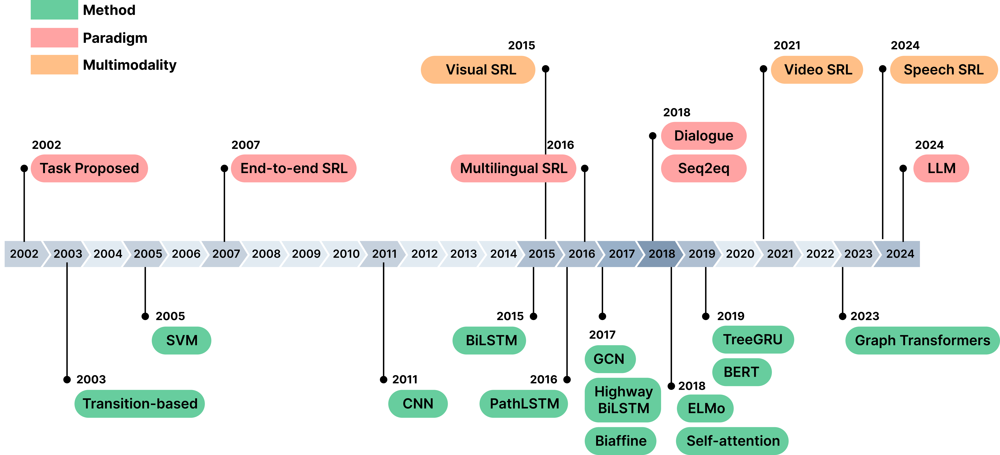

# Awesome-SRL

Awesome paper about semantic role labeling

The organization of papers is discussed in our survey: [Semantic Role Labeling: A Systematical Survey](https://arxiv.org/abs/2502.08660).

If you find any relevant academic papers that have not been included in our research, please submit a request for an update. We welcome contributions from everyone.

If any suggestions or mistakes, please feel free to let us know via email at **chenhy1018@gmail.com**. We appreciate your feedback and help in improving our work.

If you find our survey useful for your research, please cite the following paper:

    @article{chen2025semantic,
    title={Semantic Role Labeling: A Systematical Survey},
    author={Chen, Huiyao and Zhang, Meishan and Li, Jing and Zhang, Min and {\O}vrelid, Lilja and Haji{\v{c}}, Jan and Fei, Hao},
    journal={arXiv preprint arXiv:2502.08660},
    year={2025}
    }

## 📒 Table of Contents (Continuous updating...)
- ⭐️ [Datasets](#datasets) (with Download Link~)
    - [Textual SRL](#textual-srl)
    - [Visual SRL](#visual-srl)
    - [Video SRL](#video-srl)
    - [Speech SRL](#speech-srl)
- [Method](#method)
    - [Statistical Machine Learning Methods](#statistical-machine-learning-methods)
    - [Neural Network Methods](#neural-network-methods)
    - [Pre-trained Language Models](#pre-trained-language-models)
    - [Graph-based Methods](#graph-based-methods)
    - [Large Language Models](#large-language-models)
    - [Multimodal Methods](#multimodal-methods)
## Project Format Reference

This project follows the format of [Awesome-LLM4IE-Papers](https://github.com/quqxui/Awesome-LLM4IE-Papers/blob/main/README.md).

# Datasets
A taxonomy by various modals.
## Textual SRL
| Dataset | Style | Corpus | Scale | Scenario | Languages | Link |
| :----- | :-------: | :--------------: | :-------: | :---------: |:---------: |:---------: |
| [FrameNet](https://aclanthology.org/P98-1013.pdf) | FrameNet | British National Corpus | > 200,000 | sentence | En | [Link](https://framenet.icsi.berkeley.edu/) |
| [PropBank](https://aclanthology.org/J05-1004.pdf) | PropBank | PTB, robotic surgery books | > 100,000 | sentence | En | [Link](https://verbs.colorado.edu/~mpalmer/projects/ace.html) |
| [CoNLL 2005](https://aclanthology.org/W05-0620.pdf) | PropBank | Wall Street Journal in PTB,   Brown corpus in PTB | 44,020 | sentence | En | [Github   (Only Test)](https://github.com/PaddlePaddle/Paddle/blob/release/1.6/python/paddle/dataset/conll05.py#L205) |
| [CoNLL 2009](https://aclanthology.org/W09-1201.pdf) | PropBank | PTB 3, BBN's NE, PropBank 1, NomBank CPB AnCora Prague Dependency Treebank 2.0 SALSA Kyoto University | 41,678 24,833 31,116 42,940 38,020 4,893 | sentence | En Zh Ca, Es Cs De Ja | [Link   (Ca, Es, Cs, De, Ja)](https://catalog.ldc.upenn.edu/LDC2012T03)     [Link   (En, Zh)](https://catalog.ldc.upenn.edu/LDC2012T04)|
| [NomBank](https://aclanthology.org/W04-2705.pdf) | NomBank | NOMLEX-PLUS, PTB | 114,576 | sentence | En | [Link](https://catalog.ldc.upenn.edu/LDC2008T23) |
| [CoNLL 2012](https://aclanthology.org/W12-4501.pdf) | PropBank | OntoNotes | 94,269   47,042   9,395 | sentence | En   Zh   Ar | [Link](https://conll.cemantix.org/2012/data.html) |
| [HuRIC](https://www.sciencedirect.com/science/article/pii/S0004370218302935#tbl0030) | FrameNet | Human Robot Interaction | 897 | command | En, It | [Link](http://sag.art.uniroma2.it/demo-software/huric/) |
| [ConSD](https://arxiv.org/pdf/1911.02851) | PropBank | PTB, PropBank, NomBank | 44,020 | sentence | En |  |
| [Universal PropBank](https://aclanthology.org/2022.lrec-1.181.pdf) | PropBank | UD | 3,860,000 | sentence | Cs, De, El, Es, Fi, Fr, Hi, Hu, Id, It, Ja, Ko, Mr, Nl, Pr, Pt, Ro, Ru, Ta, Te, Uk, Vi, Zh | [Link](https://universalpropositions.github.io/) |
| [NounAtlas](https://aclanthology.org/2024.acl-long.857.pdf) | PropBank | OntoNotes | 28,064 | sentence | En | [GitHub](https://github.com/SapienzaNLP/nounatlas) |

## Visual SRL
| Dataset | Corpus | Scale | Scenario | Languages | Link |
| :----- | :--------------: | :-------: | :---------: |:---------: |:---------: |
| [V-COCO](https://arxiv.org/pdf/1505.04474) | COCO | 10,000 | image | En | [GitHub](https://github.com/s-gupta/v-coco) |
| [SituNet](https://www.cv-foundation.org/openaccess/content_cvpr_2016/papers/Yatskar_Situation_Recognition_Visual_CVPR_2016_paper.pdf#:~:text=In%20this%20paper%2C%20we%20argue%20for%20explicitly%20en-coding,in%20cur-rent%20paradigms%20of%20recognition%2C%20in%20image%20understanding.) | Google image | 126,102 | image | En | [GitHub](https://github.com/my89/imSitu) |
| [SWiG](https://www.ecva.net/papers/eccv_2020/papers_ECCV/papers/123490307.pdf) | Google image | 126,102 | image | En | [GitHub](https://github.com/allenai/swig) |
| [ExHVV](https://arxiv.org/pdf/2212.00715) | HVVMemes | 4,680 | image | En | [GitHub](https://github.com/shiv6891/EXCLAIM_WEB/tree/7a28639e2867ad55f1397ba13bf4bbcbe6a344d8/Artifacts/Data) | 
| [Synthetic Multimodal Dataset](https://aclanthology.org/2025.emnlp-main.1212.pdf) | Synthetic (Diffusion Models) | 11,000+ | image-command | En | [GitHub](https://github.com/crux82/GroundedSRL4HRI) |

## Video SRL
| Dataset | Corpus | Scale | Scenario | Languages | Link |
| :----- | :--------------: | :-------: | :---------: |:---------: |:---------: |
| [VidStu](https://openaccess.thecvf.com/content/CVPR2021/papers/Sadhu_Visual_Semantic_Role_Labeling_for_Video_Understanding_CVPR_2021_paper.pdf) | MovieClips | 3,037 | video | En | [GitHub](https://github.com/TheShadow29/VidSitu) |

## Speech SRL
| Dataset | Corpus | Scale | Scenario | Languages | Link |
| :----- | :--------------: | :-------: | :---------: |:---------: |:---------: |
| [AS-SRL](https://aclanthology.org/2024.findings-acl.527.pdf) | AISHELL-1, CPB | 9,000 | speech | Zh | [GitHub](https://github.com/DreamH1gh/SpeechSRL)   🤗[Hugging Face](https://huggingface.co/datasets/Santu00/AS-SRL)|

# Method
A taxonomy by various learning paradigms.
## Statistical Machine Learning Methods
|  Paper  |      Venue    |   Date  | Code |
| :----- | :--------------: | :------- | :---------: |
| [Automatic Labeling of Semantic Roles](https://aclanthology.org/J02-3001.pdf) | CL | 2002 | - |
| [Shallow Semantic Parsing using Support Vector Machines](https://aclanthology.org/N04-1030.pdf) | NAACL | 2004 | - |
| [Calibrating Features for Semantic Role Labeling](https://aclanthology.org/W04-3212.pdf) | EMNLP | 2004 | - |
| [Automatic semantic role labeling for Chinese verbs](https://www.researchgate.net/profile/Martha_Palmer2/publication/220814801_Automatic_Semantic_Role_Labeling_for_Chinese_Verbs/links/5b080fe84585157f8713e740/Automatic-Semantic-Role-Labeling-for-Chinese-Verbs.pdf) | IJCAI | 2005 | - |
| [Towards Robust Semantic Role Labeling](https://aclanthology.org/N07-1070.pdf) | NAACL | 2007 | - |
| [A Global Joint Model for Semantic Role Labeling](https://aclanthology.org/J08-2002.pdf) | CL | 2008 | - |
| [Tree Kernels for Semantic Role Labeling](https://aclanthology.org/J08-2003.pdf) | CL | 2008 | - |
| [Labeling Chinese Predicates with Semantic Roles](https://aclanthology.org/J08-2004.pdf) | CL | 2008 | - |

## Neural Network Methods
|  Paper  |      Venue    |   Date  | Code |
| :----- | :--------------: | :------- | :---------: |
| [Natural Language Processing (Almost) from Scratch](https://www.jmlr.org/papers/volume12/collobert11a/collobert11a.pdf) | JMLR | 2011 | - |
| [End-to-end learning of semantic role labeling using recurrent neural networks](https://aclanthology.org/P15-1109.pdf) | ACL | 2015 | - |
| [Joint A* CCG Parsing and Semantic Role Labelling](https://aclanthology.org/D15-1169.pdf) | EMNLP | 2015 | - |
| [Deep Semantic Role Labeling: What Works and What's Next](https://aclanthology.org/P17-1044.pdf) | ACL | 2017 | [GitHub](https://github.com/luheng/deep_srl) |
| [Linguistically-Informed Self-Attention for Semantic Role Labeling](https://aclanthology.org/D18-1548.pdf) | EMNLP | 2018 | [GitHub](https://github.com/strubell/LISA) |
| [Syntax for Semantic Role Labeling, To Be, Or Not To Be](https://aclanthology.org/P18-1192.pdf) | ACL | 2018 | - |

## Pre-trained Language Models
|  Paper  |      Venue    |   Date  | Code |
| :----- | :--------------: | :------- | :---------: |
| [Deep contextualized word representations](https://aclanthology.org/N18-1202.pdf) | NAACL | 2018 | [GitHub](https://github.com/allenai/allennlp) |
| [BERT: Pre-training of Deep Bidirectional Transformers for Language Understanding](https://aclanthology.org/N19-1423.pdf) | NAACL | 2019 | [GitHub](https://github.com/google-research/bert) |
| [BERT for Joint Intent Classification and Slot Filling](https://arxiv.org/pdf/1902.10909) | arXiv | 2019 | [GitHub](https://github.com/monologg/JointBERT) |
| [Semantic Role Labeling as Dependency Parsing: Exploring Latent Tree Structures Inside Arguments](https://aclanthology.org/2020.coling-main.230.pdf) | COLING | 2020 | - |
| [Semantic Role Labeling with Iterative Structure Refinement](https://aclanthology.org/2020.emnlp-main.232.pdf) | EMNLP | 2020 | - |
| [Semantic Role Labeling Guided Multi-turn Dialogue ReWriter](https://aclanthology.org/2021.emnlp-main.537.pdf) | EMNLP | 2021 | [GitHub](https://github.com/xuyan0213/srlguideddialogue) |
| [Grounding End-to-End Pre-trained architectures for Semantic Role Labeling in multiple languages](https://journals.sagepub.com/doi/abs/10.3233/IA-230012) | Intelligenza Artificiale | 2023 | [GitHub](https://github.com/crux82/grounded-srl) |
| [Transformer-based Swedish Semantic Role Labeling through Transfer Learning](https://aclanthology.org/2024.lrec-main.1458.pdf) | LREC | 2024 | [Språkbanken Text](https://spraakbanken.gu.se/) |
| [A New Method for Cross-Lingual-based Semantic Role Labeling](https://arxiv.org/abs/2408.15896) | arXiv | 2024 | [GitHub](https://github.com/SapienzaNLP/unify-srl) |
| [NounAtlas: Filling the Gap in Nominal Semantic Role Labeling](https://aclanthology.org/2024.acl-long.857.pdf) | ACL | 2024 | [GitHub](https://github.com/SapienzaNLP/nounatlas) |
| [Semantic role labeling from chinese speech via end-to-end learning](https://aclanthology.org/2024.findings-acl.527.pdf) | ACL Findings | 2024 | [GitHub](https://github.com/DreamH1gh/SpeechSRL) |
| [Semantic Role Labeling Guided Out-of-distribution Detection](https://aclanthology.org/2024.lrec-main.1275.pdf) | LREC | 2024 | - |

## Graph-based Methods
|  Paper  |      Venue    |   Date  | Code |
| :----- | :--------------: | :------- | :---------: |
| [Encoding Sentences with Graph Convolutional Networks for Semantic Role Labeling](https://aclanthology.org/D17-1159.pdf) | EMNLP | 2017 | [GitHub](https://github.com/diegma/neural-dep-srl) |
| [Semantic Role Labeling with Associated Memory Network](https://aclanthology.org/N19-1340.pdf) | NAACL | 2019 | - |
| [Semantic Role Labeling Meets Definition Modeling: Using Natural Language to Describe Predicate-Argument Structures](https://aclanthology.org/2022.findings-emnlp.313.pdf) | EMNLP Findings | 2022 | [GitHub](https://github.com/SapienzaNLP/dsrl) |
| [Syntax-aware Graph Attention Network for Semantic Role Labeling](https://aclanthology.org/2023.repl4nlp-1.15.pdf) | RepL4NLP | 2023 | - |

## Large Language Models
|  Paper  |      Venue    |   Date  | Code |
| :----- | :--------------: | :------- | :---------: |
| [LLMs Can Also Do Well! Breaking Barriers in Semantic Role Labeling via Large Language Models](https://aclanthology.org/2025.findings-acl.1189.pdf) | ACL Findings | 2025 | [Github](https://github.com/fangfang123gh/LLM-SRL) |
| [On the Role of Semantic Proto-roles in Semantic Analysis: What do LLMs know about agency?](https://aclanthology.org/2025.findings-acl.623/) | ACL Findings | 2025 | - |
| [LLM for Semantic Role Labeling of Emotion Predicates in Russian](https://www.superfri.org/index.php/superfri/article/view/639) | Supercomputing Frontiers | 2025 | - |
| [Leveraging ChatGPT for Enhancing Arabic NLP: Application for Semantic Role Labeling and Cross-Lingual Annotation Projection](https://ieeexplore.ieee.org/abstract/document/10820541/) | IEEE Access | 2025 | - |

## Multimodal Methods
|  Paper  |      Venue    |   Date  | Code |
| :----- | :--------------: | :------- | :---------: |
| [Visual Semantic Role Labeling](https://arxiv.org/pdf/1505.04474) | arXiv | 2015 | [GitHub](https://github.com/s-gupta/v-coco) |
| [Situation Recognition: Visual Semantic Role Labeling for Image Understanding](https://www.cv-foundation.org/openaccess/content_cvpr_2016/papers/Yatskar_Situation_Recognition_Visual_CVPR_2016_paper.pdf) | CVPR | 2016 | [GitHub](https://github.com/my89/imSitu) |
| [Grounded Situation Recognition](https://www.ecva.net/papers/eccv_2020/papers_ECCV/papers/123490307.pdf) | ECCV | 2020 | [GitHub](https://github.com/allenai/swig) |
| [Visual Semantic Role Labeling for Video Understanding](https://openaccess.thecvf.com/content/CVPR2021/papers/Sadhu_Visual_Semantic_Role_Labeling_for_Video_Understanding_CVPR_2021_paper.pdf) | CVPR | 2021 | [GitHub](https://github.com/TheShadow29/VidSitu) |
| [Embedding contextual information in seq2seq models for grounded semantic role labeling](https://link.springer.com/chapter/10.1007/978-3-031-27181-6_33) | AIxIA | 2022 | - |
| [Grounded Semantic Role Labelling from Synthetic Multimodal Data for Situated Robot Commands](https://aclanthology.org/2025.emnlp-main.1212/) | EMNLP | 2025 | - |

## Domain-Specific Applications
|  Paper  |      Venue    |   Date  | Code |
| :----- | :--------------: | :------- | :---------: |
| [Transformer-Based Semantic Role Labeling for Crisis Events Using Semi-Supervised Learning on Low-Resource Language Twitter Texts](https://ieeexplore.ieee.org/abstract/document/11145067/) | IEEE Access | 2025 | - |
| [A systematic review on semantic role labeling for information extraction in low-resource data](https://ieeexplore.ieee.org/abstract/document/10506493/) | IEEE Access | 2024 | - |
| [Annotated data for semantic role labeling of crisis events in Indonesian Tweets](https://www.sciencedirect.com/science/article/pii/S2352340925004184) | Data in Brief | 2025 | - |
